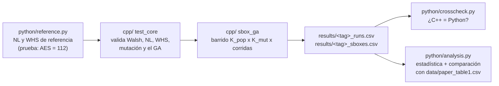

# Réplica: Evolutionary Approach to S-box Generation

Réplica de Kuznetsov et al. (2024), *Evolutionary Approach to S-box Generation: Optimizing Nonlinear Substitutions in Symmetric Ciphers* ([arXiv 2407.03510](https://arxiv.org/abs/2407.03510)), para la materia Diseño de Algoritmos Bioinspirados.

Meta: generar nuestra propia versión de la **Tabla 1** del paper (S-boxes evaluadas antes de llegar a NL = 104, por cada combinación de K_pop y K_mut) y compararla contra la publicada, agregando lo que el paper no reporta: dispersión, mediana y corridas censuradas.

## La tubería



| Pieza | Lenguaje | Para qué |
| --- | --- | --- |
| `python/reference.py` | Python | Fórmulas claras y lentas. Es la "verdad" contra la que se valida el C++. |
| `cpp/` | C++17 | El experimento pesado: millones de evaluaciones con varios hilos. |
| `python/crosscheck.py` | Python | Recalcula NL y WHS de S-boxes que generó el C++ y compara. |
| `python/analysis.py` | Python | Media, mediana, DE, IQR, censuradas y diferencia contra el paper. |
| `data/paper_table1.csv` | — | La Tabla 1 del paper transcrita (p. 9). |

## Orden de trabajo

Lo que está marcado `TODO` es lo que te toca. Todo lo demás (lectura de argumentos, semillas, hilos, CSV, reanudar, análisis) ya está hecho.

1. **TODO(A–C)** en `python/reference.py`: Walsh, NL y WHS. Listo cuando `python python/reference.py` diga OK.
2. **TODO(1–3)** en `cpp/src/walsh.cpp`: lo mismo en C++. Listo cuando pasen las pruebas de la sección "Walsh, NL y WHS".
3. **TODO(4)** en `cpp/src/ga.cpp`: la mutación por swap.
4. **TODO(5)** en `cpp/src/ga.cpp`: el ciclo del algoritmo. Listo cuando pasen las 15 pruebas.
5. `./build/sbox_ga --bench 3000` para saber la velocidad de tu máquina y decidir cuánto del grid correr.
6. Una prueba chica, verificación cruzada y análisis (comandos abajo).
7. El grid grande. Se puede cortar y retomar: vuelve a lanzar el mismo comando y salta lo ya hecho.

## Comandos

```bash
# compilar (en la carpeta del repo)
cmake -S . -B build -DCMAKE_BUILD_TYPE=Release
cmake --build build -j

# pruebas del núcleo
./build/test_core

# velocidad de tu máquina
./build/sbox_ga --bench 3000

# prueba chica: 5 corridas de la mejor configuración del paper
./build/sbox_ga --kpop 1 --kmut 7 --runs 5 --tag prueba

# verificar y analizar
python python/crosscheck.py results/prueba_sboxes.csv
python python/analysis.py results/prueba_runs.csv

# grid completo del paper (11 x 11 x 100 = 12,100 corridas)
./build/sbox_ga --kpop 1:21:2 --kmut 1:31:3 --runs 100 --tag paper
```

`./build/sbox_ga --help` lista todas las opciones. Python necesita `numpy`, `scipy` y `pandas`.

## Supuestos de implementación

El paper es ambiguo en estos puntos; aquí está lo que decidimos (va directo a la sección de supuestos del reporte):

| # | Supuesto | Por qué |
| --- | --- | --- |
| A1 | La población inicial son K_pop S-boxes aleatorias (Fisher-Yates). | El paper no dice el tamaño inicial. |
| A2 | K_Sbox cuenta **toda** evaluación, incluida la población inicial y la ganadora. | El paper no define el conteo. |
| A3 | Padres e hijos compiten juntos en la selección (esquema μ + λ). | Se deduce de `S_pop ∪ {S'}` en el pseudocódigo. |
| A4 | Cada hijo es UNA copia del padre con UN swap; K_mut = hijos por padre. | `S' ← S` está dentro del ciclo de k. |
| A5 | Selección: mayor NL primero; si empatan, menor WHS. | Sec. 4.1 lo describe sin detallar empates. |
| A6 | En la mutación se fuerza i ≠ j. | El texto lo dice; el pseudocódigo no lo garantiza. |
| A7 | Si se agotan las 150,000 iteraciones, la corrida se reporta como censurada. | El paper no reporta qué pasó en ese caso. |

## Salidas

- `results/<tag>_runs.csv`: una fila por corrida (`k_pop, k_mut, run, seed, success, k_sbox, iterations, nl, whs, seconds`).
- `results/<tag>_sboxes.csv`: la S-box final de cada corrida en hex (512 caracteres), para verificar o analizar después.
- `results/<tag>_config.txt`: parámetros usados.

Cada corrida tiene su propia semilla, derivada de la semilla base y de (K_pop, K_mut, corrida). Misma semilla, mismo resultado, sin importar cuántos hilos uses.

## Presupuesto de cómputo

El grid completo son unos **1.4 × 10⁹ evaluaciones** (suma de la Tabla 1 × 100). En la máquina donde se probó, la versión directa (sin optimizar) da ~1,600 evaluaciones por segundo por hilo; con 8 hilos eso son ~30 horas. Tu `--bench` te da tu número real.

Opciones si no alcanza: menos corridas por celda (por ejemplo 30), una parte del grid (todo K_pop con K_mut ∈ {1, 7, 31}), o la optimización incremental (un swap solo cambia 2 de los 256 valores; el espectro se puede actualizar sin recalcularlo completo).
